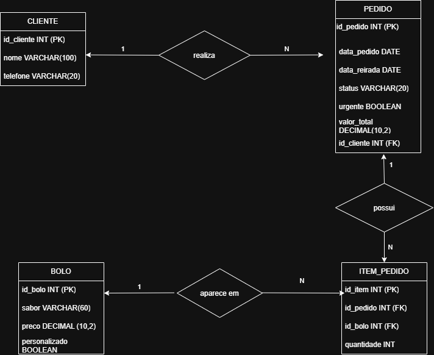

# Sistema de Bolos da Neide

Este repositório apresenta o sistema criado para a cliente Bolos da Neide.

O projeto tem como finalidade facilitar a organização das encomendas de bolos, possibilitando o cadastro dos dados dos clientes, como nome e telefone, e o controle dos pedidos, incluindo os sabores selecionados e as datas de entrega.

## Diagrama do Banco de Dados (DER)

